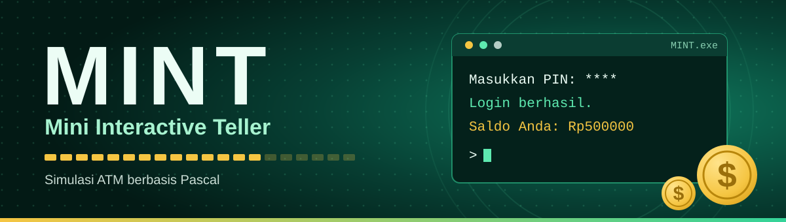

<div align="center">



<br><br>

**Simulasi ATM sederhana yang berjalan penuh warna di terminal, ditulis dengan Pascal.**

<br>


</div>

<br>

## Tentang MINT

**MINT** (*Mini Interactive Teller*) menirukan pengalaman memakai mesin ATM: masuk dengan PIN, mengecek saldo, menyetor, menarik uang, melihat riwayat transaksi, dan mencoba simulasi bunga tabungan. Semuanya berjalan di layar terminal dengan tampilan berwarna dan layar pembuka bergaya loading bar.

<br>

## Tampilan program

Layar pembuka:

```text
=================================
         M I N I   B A N K
      Mini Interactive Teller
=================================

Memuat sistem ████████████████████

Selesai! Membuka Mini Bank...
```

Menu utama:

```text
======== MENU MINI BANK ========
1. Cek Saldo
2. Setor Tunai
3. Tarik Tunai
4. Simulasi Bunga Tabungan
0. Keluar
================================
Pilih menu:
```

<br>

## Menu dan aturan

| Menu | Fungsi | Aturan |
|:----:|--------|--------|
| 1 | Cek Saldo | Saldo awal Rp500.000 |
| 2 | Setor Tunai | Nominal harus lebih dari 0 |
| 3 | Tarik Tunai | Harus kelipatan Rp50.000 dan tidak melebihi saldo |
| 4 | Simulasi Bunga Tabungan | Bunga 5% per tahun, dihitung per tahun |
| 0 | Keluar | Menutup program |

**Login:** PIN diberi 3 kali kesempatan. Jika salah 3 kali, kartu diblokir dan program berhenti.

<br>

## Konsep Pascal yang dipakai

| Konsep | Dipakai untuk |
|--------|---------------|
| `if else` | Memeriksa PIN, serta memeriksa nominal dan saldo saat menarik uang |
| `while` dan `break` | Mengulang input PIN sampai 3 kali, berhenti begitu PIN benar |
| `case of` | Memilih menu 0 sampai 5, dengan `else` untuk pilihan yang tidak valid |
| `repeat until` | Menampilkan menu terus-menerus sampai user memilih 0 |
| `for to do` | Simulasi bunga per tahun, dan loading bar |
| `continue` | Melewati sisa perintah dan kembali ke menu jika nominal atau tahun kurang dari atau sama dengan 0 |
| `textcolor` | Memberi warna pada teks |
| `delay` | Menjeda program untuk efek loading |

<br>

<div align="center">

## Anggota kelompok

| No | Nama | NIM | Kelas |
|:--:|------|-----|-------|
| 1 | Nathan Althaafa Rizq | 261401103 | Kom B, Lab 4 |
| 2 | Putri Khairunnisa | 261401086 | Kom B, Lab 4 |
| 3 | Tiara Aulia Setiawan | 261401120 | Kom B, Lab 4 |

<br>

<div align="center">

Dibuat dengan Pascal oleh Kelompok Kom B, Lab 4.

<p align="center">
  
</p>

</div>
